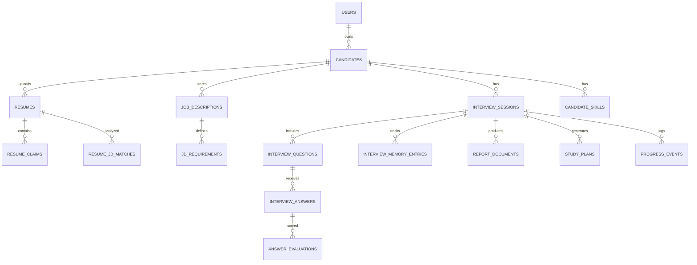
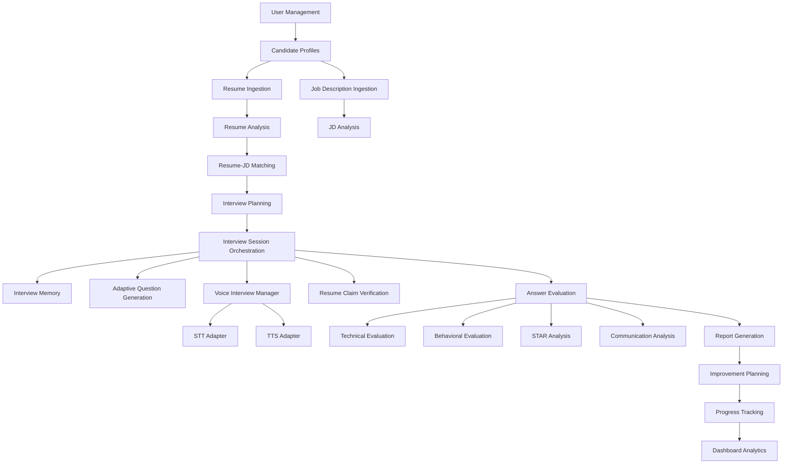

# AI Mock Interviewer — Architecture and Delivery Plan

## 1) Project analysis

### Overall assessment
This is a high-complexity project because it spans:

- document ingestion and parsing
- resume-job matching
- AI-driven interview flow
- multimodal voice processing
- memory and state tracking
- answer evaluation and explainability
- learning/report generation

The real challenge is not “calling an LLM.” The challenge is making the system reliable, auditable, adaptive, and safe.

### Complexity rating
- Functional complexity: 9/10
- AI orchestration complexity: 9/10
- Evaluation reliability: 8/10
- Production-readiness risk: 8/10
- Final-year project feasibility with discipline: 7/10

This is feasible as a final-year project only if we intentionally limit scope and build modularly.

---

## 2) Key risks

### Risk 1: LLM variability
LLMs are non-deterministic. If we ask them to judge candidate quality, it becomes flaky and hard to defend. We should avoid general-purpose “hiring decisions” and instead use structured evaluation with explicit criteria and evidence.

### Risk 2: Voice latency and interruption handling
The “Question → TTS → candidate speaks → STT → next question” loop is technically hard. Real-time latency, background noise, microphone input issues, and conversation drift can break the experience.

### Risk 3: Interview memory coherence
The system must preserve context without hallucinating relevance. This requires structured interview state, memory summarization, and explicit retrieval by stage.

### Risk 4: Explainability gap
The platform must show why a question was asked or why an answer was evaluated. Without evidence traces, the whole system feels like a black box.

### Risk 5: Evaluation quality
If answer scoring is too subjective, the system becomes hard to defend academically. We need rubric-based scoring, evidence extraction, and verdict reasons.

### Risk 6: Scope explosion
The biggest project risk is trying to build everything in one go: report generation, analytics, growth planning, progress prediction, voice, and advanced intelligence simultaneously.

---

## 3) Oversized features and what to cut

### Features that are too large for a final-year MVP
- End-to-end SaaS multi-user admin
- Real-time collaboration
- Advanced dashboard analytics at scale
- Multi-language voice support
- Full speech emotion analysis
- Automated technical reasoning benchmarking
- Full candidate ranking or hiring prediction
- Comprehensive personalized learning engine with adaptive curriculum optimizer
- Large-scale recommendation engine

### Why they are oversized
They either require:
- more product definition than a final-year project can absorb
- too much AI evaluation engineering
- too much backend + data modeling complexity
- too much validation and UX work

---

## 4) Recommended simplifications for a final-year project

### Keep
- Resume upload and parsing
- Job description intake
- Candidate profile and interview state
- Structured resume-JD matching
- Interview plan generation
- One-question-at-a-time adaptive interview loop
- Voice pipeline with text and audio
- Interview memory and follow-up generation
- Rubric-based answer evaluation
- STAR analysis
- Basic interview report and study plan
- Progress tracking across sessions

### Remove from MVP
- Any hiring prediction
- Employability score
- Candidate rejection/selection ranking
- Complex dashboard intelligence
- Multi-tenant enterprise admin
- Complex analytics beyond simple trend tracking
- Multi-voice-language support
- Deep emotion or sentiment analytics
- Large scale A/B testing or user experimentation

> The MVP should be coaching-focused, not hiring-focused. The system must never imply selection outcomes.

---

## 5) MVP definition

### MVP product definition
A system that allows:
1. a user to create a candidate profile
2. upload a resume
3. upload or paste a job description
4. generate a structured resume-JD match summary
5. create an interview plan
6. run a one-question-at-a-time adaptive interview
7. collect spoken response via STT
8. evaluate answer against rubric
9. maintain session memory and follow-up questions
10. generate a feedback report
11. create a short study plan

### MVP constraints
- Only one candidate and one interview flow at a time
- Single-user or small-user project
- No external SaaS billing layer
- No multi-tenant governance
- AI providers isolated behind interfaces
- All outputs structured as JSON for evaluation and traceability

### Success metrics for MVP
- Interview loop works reliably in a local dev setup
- Candidate can speak and receive follow-up question
- System explains why a question was asked
- Answer scoring is based on rubric and evidence
- Final report is understandable to a user

---

## 6) What should not be in the MVP

- Automated hiring recommendation
- “Candidate fit score”
- Prediction of hiring outcomes
- Full-blown analytics suite
- Generic AI chat agent
- Advanced speech analytics
- Signal-heavy real-time emotion detection
- Long-term institutional LMS features
- Cross-user benchmarking or leaderboard

---

## 7) Recommended architecture

### 7.1 Architecture style
Use Clean Architecture with dependency inversion and clear modular boundaries.

### Layers
1. Presentation/API layer
   - FastAPI routes
   - request validation
   - response serialization
   - auth/session handling later

2. Application layer
   - orchestration services
   - commands and use cases
   - interview flow orchestration
   - evaluation orchestration

3. Domain layer
   - candidate, resume, JD, interview, memory, evaluation, report domains
   - pure business rules
   - no external provider calls here

4. Infrastructure layer
   - Postgres repositories
   - file storage adapters
   - LLM provider adapters
   - STT/TTS adapters
   - logging and telemetry

5. Shared cross-cutting concerns
   - config
   - schema validation
   - security and auditing
   - observability

### 7.2 Design principles
- No route handlers contain business logic
- AI calls happen through provider interfaces, never directly in controllers
- Use typed domain models and DTOs
- Use repository pattern for persistence
- Keep interview orchestration in a dedicated service
- Use structured outputs from LLMs
- Treat scoring as evidence-based, not as black-box opinion

### 7.3 AI provider design
Create abstractions such as:
- LLMClient
- SpeechToTextClient
- TextToSpeechClient
- EmbeddingClient (optional later)

These interfaces should define methods like:
- generate_structured_response
- transcribe_audio
- synthesize_speech
- summarize_text

This ensures future provider swaps with OpenAI, Anthropic, or Gemini without changing business logic.

---

## 8) Recommended system modules

The system should be broken into these modules:

- User management
- Candidate profile management
- Resume ingestion and parsing
- Resume analysis
- Job description analysis
- Resume-JD matching
- Interview planning
- Interview session orchestration
- Interview memory
- Dynamic question generation
- Resume claim verification
- Answer evaluation
- Technical evaluation
- Behavioral evaluation
- STAR analysis
- Communication analysis
- Speech analytics
- Report generation
- Improvement planning
- Progress tracking
- Dashboard analytics
- Voice interview manager

But for MVP, do not implement all at once. Start with:
- candidate profile
- resume + JD intake
- interview planning
- voice interview loop
- answer evaluation
- report generation
- progress tracking

---

## 9) Recommended database design

### 9.1 Database choice
Use PostgreSQL with SQLAlchemy 2 and Alembic.

### 9.2 Core design principles
- Strong relational schema for interview state and facts
- JSONB for flexible AI artifacts and provider responses
- Separate raw document storage from metadata
- Keep immutable logs of evaluation evidence
- Use normalized tables for skills, questions, claims, and reports

### 9.3 Core tables
- users
- candidates
- candidate_profiles
- resumes
- job_descriptions
- candidate_skills
- resume_claims
- jd_requirements
- resume_jd_matches
- interview_sessions
- interview_stages
- interview_questions
- interview_answers
- answer_evaluations
- evaluation_criteria
- skill_gaps
- interview_memory_entries
- report_documents
- study_plans
- progress_events
- voice_sessions
- speech_transcripts
- audio_records

### 9.4 Key relationships
- candidate has many resumes
- candidate has many interview sessions
- interview session has many questions and answers
- question belongs to stage and skill area
- answer has many evaluations
- resume has claims and extracted skills
- JD has requirements
- session has memory and progress data
- report is tied to session and candidate

### 9.5 Important design choices
- Use JSONB for model outputs:
  - extracted_skill_data
  - scoring_rubrics
  - evaluation_reasoning
  - follow-up_context
  - memory snapshots
- Use explicit tables for skills, questions, and claim evidence instead of freeform text wherever possible
- Keep raw resume documents in an object storage layer if the app later grows, but keep metadata in Postgres

### 9.6 Example ER diagram



---

## 10) Recommended dependency graph



This graph shows the correct dependency direction: core domain facts feed interviews, interviews produce evaluations, evaluations generate reports and study plans.

---

## 11) Recommended interview architecture

### Core interview loop
The interview should be built around a strict orchestration pipeline:

1. Load candidate profile
2. Load resume content and skill insights
3. Load JD requirements
4. Load interview stage and history
5. Select next question by rubric and memory
6. Generate TTS audio
7. Candidate speaks
8. STT transcribes
9. Evaluate answer
10. Update memory and skill gaps
11. Decide whether to ask a follow-up or move to next stage
12. Repeat

### Design rule
The system must ask one question at a time. It must not generate an entire interview script in one go.

### Why this matters
This reduces LLM drift, keeps the user engaged, and makes the experience feel like a real interviewer.

---

## 12) Explainability design

This is a major differentiator.

### Must-have explainability mechanisms
- Why was this question selected?
  - based on missing skill
  - based on resume evidence
  - based on prior answer weakness
  - based on JD requirement
- Why was this answer scored this way?
  - rubric factor
  - evidence extraction
  - reasoning trace
  - improvement suggestions
- Why was a follow-up question asked?
  - clarification needed
  - strong/weak signal
  - missing detail in STAR answer
  - competency gap

### If explainability is weak, the project fails
A final-year evaluation will ask:
- Why did the system ask that question?
- Why did it score the answer that way?
- How does the system decide follow-up questions?
- How is the system different from a generic chatbot?

The answer must be:
- structured
- traceable
- evidence-based
- human-auditable

---

## 13) Interview intelligence design

### Interview planning should be rule-driven
Use a domain model for:
- interview stage
- competency areas
- rubric categories
- difficulty
- question type
- expected evidence

### Interview flow should adapt based on:
- previous answers
- resume content
- JD requirement coverage
- skill gaps
- question history
- time spent on stage
- user performance trend
- answer confidence

### Important: no “hiring prediction”
The platform coaches, it does not say who will be hired.

---

## 14) Evaluation framework design

### Evaluation must be rubric-based
Each answer should be evaluated against a rubric such as:
- technical correctness
- depth of explanation
- clarity
- structure
- evidence quality
- STAR completeness
- communication quality
- alignment to JD

### Output for each answer
- score per dimension
- strengths
- weaknesses
- evidence
- suggested improvement
- follow-up prompts

### Evaluation pipeline
1. Extract facts from answer
2. Link facts to resume claims / JD requirements
3. Score against rubric
4. Identify gaps
5. Produce structured feedback
6. Decide next question

### This makes the platform academically defensible
It is not a vague “AI opinion”; it is a structured assessment process.

---

## 15) Eight-week implementation roadmap

### Week 1 — Project setup and architecture freeze
- define domain model
- finalize scope and MVP boundaries
- choose architecture
- set up FastAPI + Postgres + Docker structure
- create ADRs and design docs
- define evaluation rubric schema

### Week 2 — Data model and persistence
- design database schema
- configure models and migrations
- build candidate/resume/JD entities
- add repositories and service skeletons
- create seed data and validation tests

### Week 3 — Resume and JD analysis foundations
- resume parsing pipeline
- skill extraction
- JD requirement extraction
- initial matching logic
- test parsing quality on sample documents

### Week 4 — Interview planning and memory model
- interview stage definitions
- question bank
- memory entity design
- session state service
- first adaptive question selection logic

### Week 5 — Voice interview MVP
- TTS provider abstraction
- STT provider abstraction
- orchestrated question cycle
- one-question-at-a-time flow
- session recording and transcript persistence

### Week 6 — Answer evaluation
- rubric framework
- scoring service
- STAR extraction
- claim verification hooks
- narrative feedback generation

### Week 7 — Reports and study plans
- report generation service
- initial progress tracking
- study-plan recommendations
- final candidate feedback bundle

### Week 8 — Hardening and demo preparation
- end-to-end tests
- error handling
- observability
- demo dataset
- finalize documentation
- prepare project presentation

---

## 16) Milestone breakdown

### Milestone 1 — Voice Interview MVP
Focus:
- TTS
- STT
- interview session orchestration
- one-question flow
- memory state
Deliverables:
- working voice interview loop
- transcript persistence
- safe fallback on errors

### Milestone 2 — Interview Agent
Focus:
- dynamic follow-up logic
- question selection
- stateful memory
- stage-aware probing
Deliverables:
- interview agent service
- question selection rules
- adaptive follow-up engine

### Milestone 3 — Resume + JD Intelligence
Focus:
- parsing
- skill extraction
- resume/JD matching
- claim verification preparation
Deliverables:
- structured resume and JD analysis
- match summary
- candidate skill profile

### Milestone 4 — Evaluation Framework
Focus:
- rubric-based evaluation
- STAR analysis
- communication analysis
- answer scoring service
Deliverables:
- answer evaluation pipeline
- structured weakness/strength output

### Milestone 5 — Speech Analytics
Focus:
- transcript quality
- response timing
- filler analysis
- speaking clarity indicators
Deliverables:
- speech quality metrics
- insights beyond raw transcript

### Milestone 6 — Advanced Intelligence
Focus:
- deeper reasoning
- adaptive learning levels
- deeper personalization
- improved report generation
Deliverables:
- stronger personalization and coaching logic

### Milestone 7 — Progress Tracking
Focus:
- longitudinal improvement tracking
- study plan updates
- trend analysis
Deliverables:
- session comparison
- progress insights
- coaching recommendations

---

## 17) Repository structure recommendation

This is the recommended high-level structure for the project:

```text
ai_interviewer/
├── app/
│   ├── api/
│   │   ├── deps/
│   │   ├── routes/
│   │   │   ├── candidates.py
│   │   │   ├── resumes.py
│   │   │   ├── jobs.py
│   │   │   ├── interviews.py
│   │   │   └── reports.py
│   │   └── schemas/
│   ├── core/
│   │   ├── config.py
│   │   ├── logging.py
│   │   └── security.py
│   ├── domain/
│   │   ├── models/
│   │   ├── services/
│   │   ├── repositories/
│   │   └── interfaces/
│   ├── infrastructure/
│   │   ├── db/
│   │   ├── llm/
│   │   ├── speech/
│   │   ├── storage/
│   │   └── telemetry/
│   ├── use_cases/
│   │   ├── resume_analysis/
│   │   ├── jd_analysis/
│   │   ├── interview_flow/
│   │   ├── evaluation/
│   │   └── reporting/
│   └── main.py
├── tests/
│   ├── unit/
│   ├── integration/
│   ├── api/
│   └── fixtures/
├── docs/
│   ├── architecture/
│   ├── api/
│   ├── roadmap/
│   └── decisions/
├── alembic/
├── docker/
│   ├── Dockerfile
│   └── docker-compose.yml
├── .env.example
├── requirements.txt
├── pytest.ini
├── README.md
└── Makefile
```

This structure keeps modules independent and testable.

---

## 18) Recommended engineering decisions

### 18.1 Use async database and async service boundaries
FastAPI with async SQLAlchemy is appropriate for interview sessions and streaming operations.

### 18.2 Keep LLM logic behind adapters
Never let FastAPI route handlers call LLMs directly.

### 18.3 Use structured outputs
LLM responses should be JSON-first with strict schema validation.

### 18.4 Keep evidence and reasoning traceable
Every evaluation should store:
- rubric version
- evidence snippets
- generated explanation
- score values
- confidence level

### 18.5 Design for future frontends
All features should be exposed through APIs. Future React, Next.js, Streamlit, or Gradio clients can call the same backend.

---

## 19) Final recommendation

### Best strategy
Build this as:
- FastAPI + PostgreSQL + Docker
- modular domain-driven backend
- strict interview orchestration
- provider-abstraction for AI/speech
- structured evaluation and explainability
- precise MVP with clear boundaries

### Best first product
The best final-year demonstrator is:
- resume and JD ingestion
- interview planning
- real-time voice interview loop
- adaptive follow-up generation
- evidence-based answer scoring
- final coaching report

This is credible, impressive, and technically strong enough for project evaluation.

---

## 20) Summary

### Project status
This project is ambitious but feasible if properly constrained.

### Complexity
High, but manageable with disciplined modular design.

### Biggest risks
- LLM unreliability
- voice latency and conversational drift
- evaluation subjectivity
- scope explosion

### Recommended MVP
Voice interview coach with resume/JD-aware adaptive questioning, rubric-based evaluation, and explainable coaching reports.

### Not allowed in MVP
Hiring predictions, applicant ranking, employment scorecards, and black-box AI assessments.
